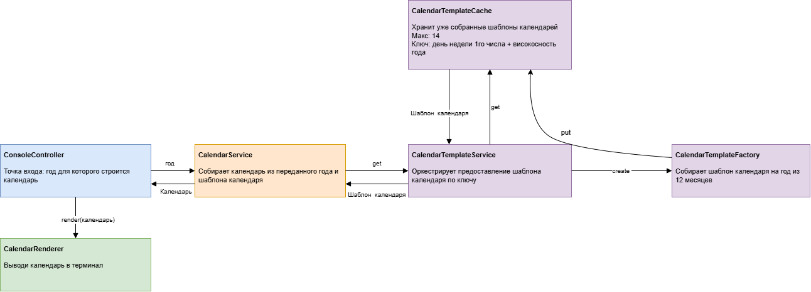

Календарь года полностью определяется двумя признаками: на какой день недели
приходится 1 января и високосный ли год. 7 × 2 = 14

Ответ: **14**

Из этого появилась идея решения: определить тип года и генерировать календарь по необходимости, а рендерить отдельно

* домен не зависит от ввода-вывода
* кеш и рендерер заменяемы

